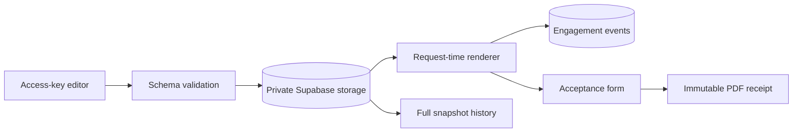

# Proposal Editor

A Next.js and Supabase editor that publishes JSON-backed proposals instantly, tracks reader engagement, preserves every version, and creates a signed PDF receipt on acceptance.

## Why I built it

I wanted proposal copy to change without waiting for a deployment, while keeping the editing surface and service credentials away from the public page. I also needed a clean audit trail: what the reader saw, which version they accepted, and a receipt both sides can retain. The result is a small content system with deliberate failure boundaries instead of a page builder.

## How it works



- Each proposal is one validated JSON document in a private Storage bucket.
- The public page reads the current object on every request with caching disabled.
- A save uses optimistic concurrency. If the stored timestamp changed, the API returns `409` instead of overwriting another edit.
- Every successful save also writes a complete, independent history snapshot.
- Themes come from a fixed registry. Content can choose a theme, but cannot inject CSS or HTML.
- The renderer records anonymous session views and active seconds. It does not collect names, email addresses, IP addresses, or browser fingerprints.
- Acceptance binds the signer to the exact JSON snapshot by SHA-256 hash and writes a private, bearer-link PDF receipt.

## Design decisions and guardrails

- The Supabase service role is imported only by server code. It is never prefixed with `NEXT_PUBLIC` and never sent to the browser.
- `/edit`, content APIs, and history APIs require a server-verified access key in Supabase mode. The cookie contains a hash of the key, not the key itself, and expires after 12 hours.
- Proposal slugs, history IDs, signer fields, events, array sizes, and text lengths are validated before storage access.
- The renderer emits React text nodes only. Proposal JSON cannot add scripts, raw HTML, or arbitrary styles.
- Save conflicts stop with `409`. A stale browser tab cannot silently replace a newer proposal.
- Receipts are immutable. Storage uses `upsert: false`, acceptance is one-time, and a failed acceptance write removes the orphaned PDF.
- Receipt URLs contain an unguessable UUID and responses are private with `no-store` and `nosniff` headers. The public page exposes only signed status, never signer identity or the receipt URL.
- A hashed submission ID makes signature retries idempotent without letting a later visitor retrieve the first signer's receipt.
- Demo mode never writes to the fixture. Changes, events, history, and signatures stay in process memory and reset on restart.
- History is a safety net, not a patch chain. Every restore point is a complete JSON document.

## Quick start

### Local demo, no accounts or keys

```bash
npm install
npm run dev
```

Open `http://localhost:3000` for the fictional Northwind Dental proposal or `http://localhost:3000/edit` for the editor board. Save a change, refresh the public proposal, open History, and sign the proposal. The PDF receipt is generated locally in memory.

Run the offline schema tests:

```bash
npm test
```

### Supabase mode

1. Create a Supabase project and run [`supabase/setup.sql`](supabase/setup.sql) in its SQL editor.
2. Copy `.env.example` to `.env.local` and replace every placeholder.
3. Start the app with `npm run dev`.
4. Visit `/edit/login`, enter `EDITOR_ACCESS_KEY`, and add proposal JSON to the private bucket using the demo fixture as a schema example.

Production mode activates only when both `SUPABASE_URL` and `SUPABASE_SERVICE_ROLE_KEY` are present. If either is missing, the app intentionally uses the local fictional demo.

## Example output

The included fixture renders a proposal for the fictional company Northwind Dental and contact Jamie Rivera. The editor card shows:

```text
Patient Follow-up Workflow
Theme: cedar
Views: 0
Active time: 0s
Status: Open
```

After acceptance, the status changes to `Signed` and the page offers a PDF receipt containing the signer identity, timestamp, proposal version, snapshot hash, and receipt ID.

## Tech

- TypeScript, React 18, and Next.js 14 App Router
- Supabase Storage for current JSON, history snapshots, acceptance records, and PDF receipts
- Supabase Postgres for privacy-minimized engagement events
- Web Crypto and Node Crypto for editor sessions, UUIDs, and SHA-256 snapshot hashes
- A dependency-free PDF writer for the one-page signed receipt
- Node's built-in test runner for offline schema tests

## License

MIT. Copyright (c) 2026 Christian Terrone.
